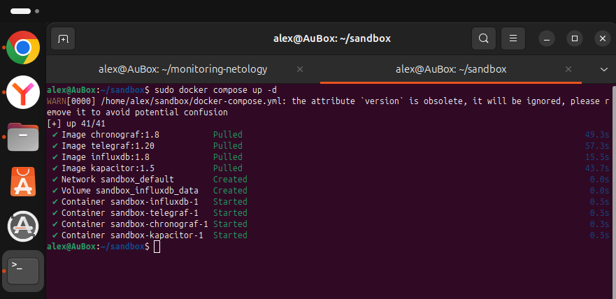
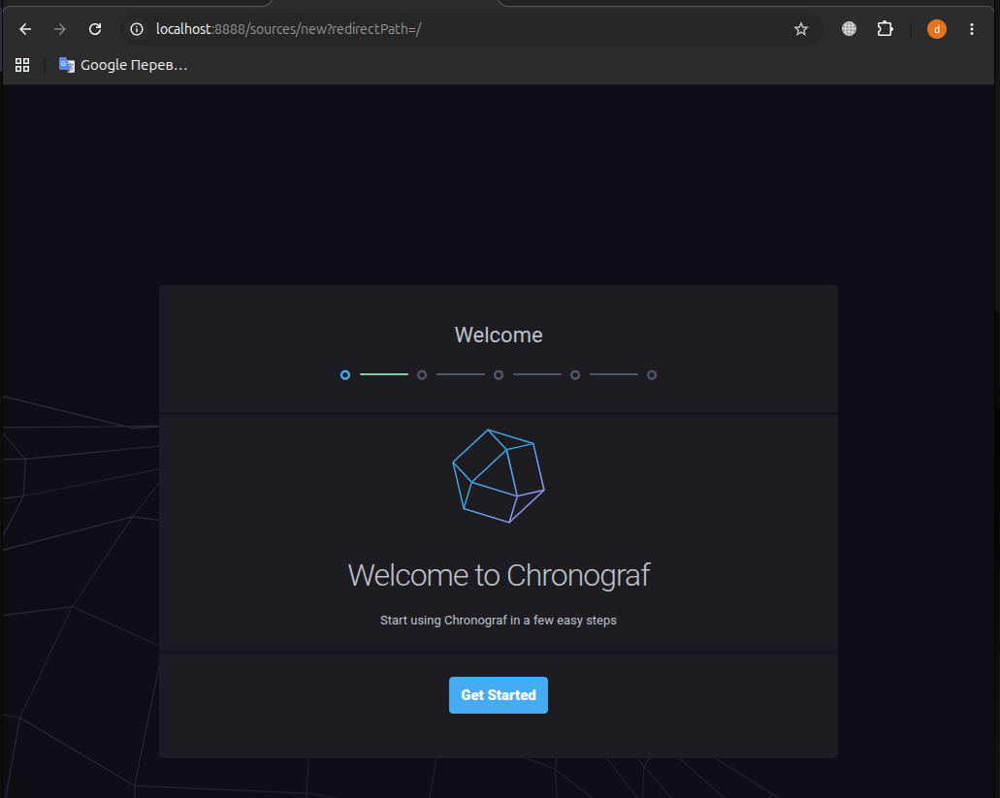
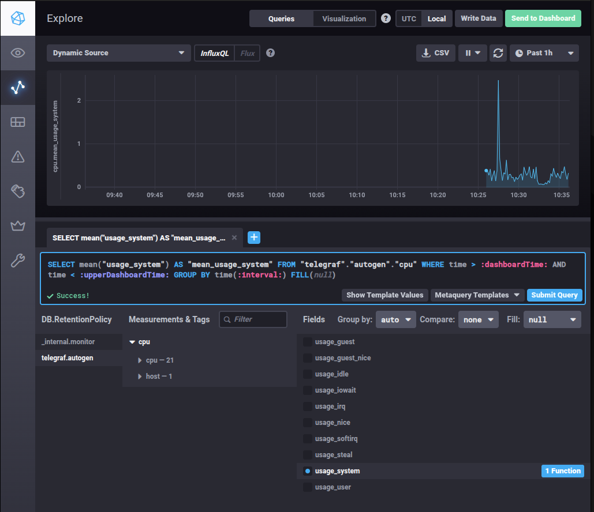
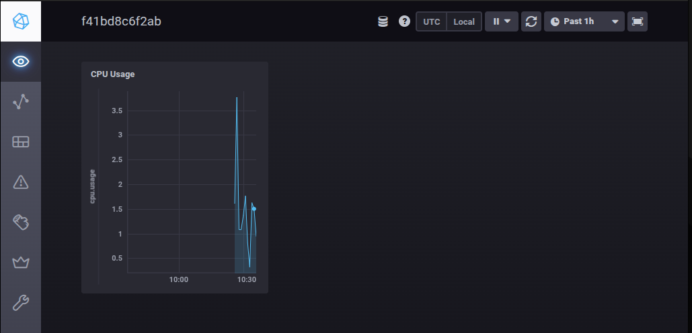
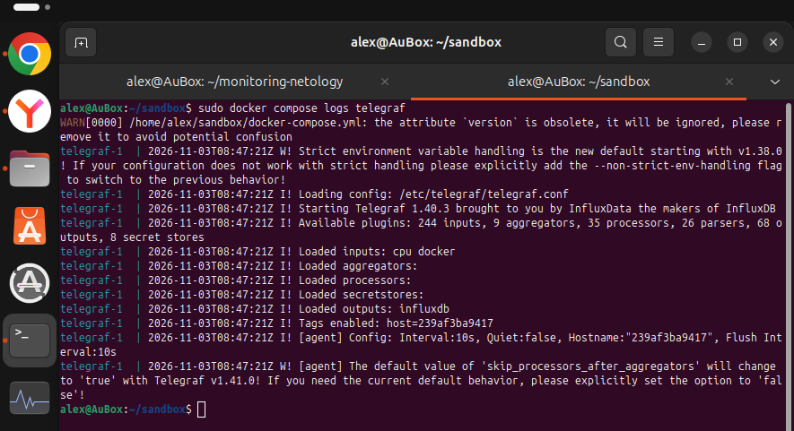
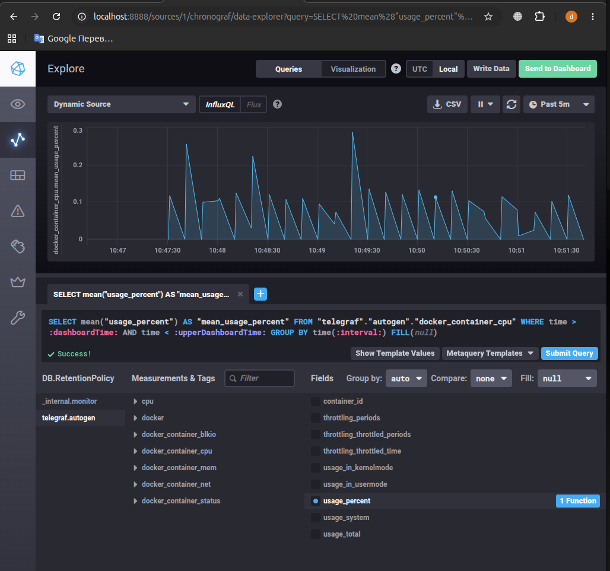

     ### Домашнее задание к занятию "13.Системы мониторинга"- Нугаев Алексей

## Обязательные задания

1. Вас пригласили настроить мониторинг на проект. На онбординге вам рассказали, что проект представляет из себя 
платформу для вычислений с выдачей текстовых отчетов, которые сохраняются на диск. Взаимодействие с платформой 
осуществляется по протоколу http. Также вам отметили, что вычисления загружают ЦПУ. Какой минимальный набор метрик вы
выведите в мониторинг и почему?
#
2. Менеджер продукта посмотрев на ваши метрики сказал, что ему непонятно что такое RAM/inodes/CPUla. Также он сказал, 
что хочет понимать, насколько мы выполняем свои обязанности перед клиентами и какое качество обслуживания. Что вы 
можете ему предложить?
#
3. Вашей DevOps команде в этом году не выделили финансирование на построение системы сбора логов. Разработчики в свою 
очередь хотят видеть все ошибки, которые выдают их приложения. Какое решение вы можете предпринять в этой ситуации, 
чтобы разработчики получали ошибки приложения?
#
4. Вы, как опытный SRE, сделали мониторинг, куда вывели отображения выполнения SLA=99% по http кодам ответов. 
Вычисляете этот параметр по следующей формуле: summ_2xx_requests/summ_all_requests. Данный параметр не поднимается выше 
70%, но при этом в вашей системе нет кодов ответа 5xx и 4xx. Где у вас ошибка?
#
5. Опишите основные плюсы и минусы pull и push систем мониторинга.
#
6. Какие из ниже перечисленных систем относятся к push модели, а какие к pull? А может есть гибридные?

    - Prometheus 
    - TICK
    - Zabbix
    - VictoriaMetrics
    - Nagios
#
7. Склонируйте себе [репозиторий](https://github.com/influxdata/sandbox/tree/master) и запустите TICK-стэк, 
используя технологии docker и docker-compose.

В виде решения на это упражнение приведите скриншот веб-интерфейса ПО chronograf (`http://localhost:8888`). 

P.S.: если при запуске некоторые контейнеры будут падать с ошибкой - проставьте им режим `Z`, например
`./data:/var/lib:Z`
#
8. Перейдите в веб-интерфейс Chronograf (http://localhost:8888) и откройте вкладку Data explorer.
        
    - Нажмите на кнопку Add a query
    - Изучите вывод интерфейса и выберите БД telegraf.autogen
    - В `measurments` выберите cpu->host->telegraf-getting-started, а в `fields` выберите usage_system. Внизу появится график утилизации cpu.
    - Вверху вы можете увидеть запрос, аналогичный SQL-синтаксису. Поэкспериментируйте с запросом, попробуйте изменить группировку и интервал наблюдений.

Для выполнения задания приведите скриншот с отображением метрик утилизации cpu из веб-интерфейса.
#
9. Изучите список [telegraf inputs](https://github.com/influxdata/telegraf/tree/master/plugins/inputs). 
Добавьте в конфигурацию telegraf следующий плагин - [docker](https://github.com/influxdata/telegraf/tree/master/plugins/inputs/docker):
```
[[inputs.docker]]
  endpoint = "unix:///var/run/docker.sock"
```

Дополнительно вам может потребоваться донастройка контейнера telegraf в `docker-compose.yml` дополнительного volume и 
режима privileged:
```
  telegraf:
    image: telegraf:1.4.0
    privileged: true
    volumes:
      - ./etc/telegraf.conf:/etc/telegraf/telegraf.conf:Z
      - /var/run/docker.sock:/var/run/docker.sock:Z
    links:
      - influxdb
    ports:
      - "8092:8092/udp"
      - "8094:8094"
      - "8125:8125/udp"
```

После настройке перезапустите telegraf, обновите веб интерфейс и приведите скриншотом список `measurments` в 
веб-интерфейсе базы telegraf.autogen . Там должны появиться метрики, связанные с docker.

Факультативно можете изучить какие метрики собирает telegraf после выполнения данного задания.


# Решение 1

* Метрики процессора, так как вычисления нагружают ЦПУ, важно видеть общую загрузку и длину очереди задач, чтобы вовремя заметить нехватку ресурсов или зависание процессов.
* Метрики дисковой подсистемы. Так как текстовые отчёты сохраняются на диск. Нужно контролировать утилизацию диска, чтобы он не переполнился. Дисковые операции ввода-вывода / Ожидание ввода-вывода  чтобы понимать, не упирается ли производительность в скорость записи отчётов.
* Метрики HTTP-взаимодействия. Частота HTTP-запросов,  количество запросов в секунду, чтобы видеть текущую нагрузку на платформу. Коды ответов HTTP, позволяют узнать об ошибках сервера или проблемах на стороне клиентов. Задержка и длительность запроса,время обработки HTTP-запросов, чтобы отслеживать деградацию производительности вычислений.
* Метрики оперативной памяти, Использование памяти это базовый контроль, чтобы процессы вычислений не упали по причине нехватке памяти.

# Решение 2

* Внедрить методологию SLI/SLO (% успешных ответов). 
* Предложить бизнес-метрики: Процент успешных HTTP-ответов, от общего числа запросов. Время генерации отчётов. Доля успешно сохранённых файлов отчётов.
* Создать в Grafana дашборд, отображающий выполнение SLO в реальном времени.

# Решение 3

* Использование стандартных средств ОС stdout / stderr.
* Можно смотреть ошибки напрямую через journalctl
* Использование бесплатных утилит локально на сервере, таких как Vector или Promtail.
* Или написать скрипт, который при появлении слов в логах ОШИБКА, КРИТИЧЕСКАЯ будет отправлять  текст ошибки в чат или на почту.
* Бесплатная Sentry Self-Hosted версия, без ограничений на объем собираемых ошибок. 

# Решение 4

* Ошибка, что считается доля успешных ответов 2xx от вообще всех запросов.
В эти «все запросы» попадают:
Перенаправления 3xx, когда сайт переводит вас с http на https. Это штатная работа, а не ошибка.
Промежуточные ответы 1xx, технические сообщения протокола.
Технический трафик, запросы от систем мониторинга health-check, балансировщиков или ботов.
Что бы правильно считать SLA, нужно делить успешные запросы 2xx только на те, которые должны были вернуть 2xx по нашей бизнес-логике.
Формула доступности. Все запросы - 4xx - 5xx.  Все запросы. Если 4xx и 5xx нет, наш SLA — 100%.
Формула 70%, это просто метрика «корректности» ответов, а не доступности системы.
Куда делись 30%. Может быть, это легитимные коды 3xx перенаправления или промежуточные 1xx, которые система мониторинга ошибочно посчитала «неуспешными».

# Решение 5

* Pull-модель (сервер забирает метрики)
* Плюсы. Легко контролировать нагрузку на сервер. Сразу видно, если приложение «умерло» — нет ответа на опрос. Не нужно настраивать аутентификацию для каждого агента.
* Минусы. Сложно собирать метрики из-за NAT или динамических задач (cron). Серверу нужен список всех адресов приложений (Service Discovery).

* Push-модель (приложения отправляют метрики сами)
* Плючы. Отлично подходит для Serverless и коротких задач. Работает через NAT и файрволы (нужен только исходящий доступ).
* Минусы. Работает через NAT и файрволы (нужен только исходящий доступ). Труднее понять, упало ли оно или просто перестало слать метрики. Нужна настройка защиты приёмника (auth).

# Решение 6

* Prometheus      Pull	Эталон pull-подхода; для коротких задач — Pushgateway
* Nagios	  Pull	Сервер сам запускает проверки через NRPE, SNMP или SSH
* TICK (InfluxData) Push Telegraf собирает метрики и пушит в InfluxDB
* Zabbix	  Гибрид Zabbix Agent (pull), Agent Active и трапы (push)
* VictoriaMetrics Гибрид Хранилище для Prometheus (приём по remote_write), но vmagent умеет и pull

# Решение 7




# Решение 8




# Задание 9. Добавление плагина docker в конфигурацию telegraf

* В файл `telegraf.conf` добавлен плагин `[[inputs.docker]]` для сбора метрик с контейнеров Docker.
* В файле `docker-compose.yml` для сервиса telegraf образ обновлен до `telegraf:latest`, включен режим `privileged: true`, добавлен `group_add: ["0"]` и примонтирован докер-сокет `/var/run/docker.sock`. Это решило проблемы с правами доступа и версиями API.
* Стек успешно перезапущен. В веб-интерфейсе Chronograf в списке measurements базы `telegraf.autogen` появились метрики `docker`, `docker_container_cpu`, `docker_container_mem` и другие.





