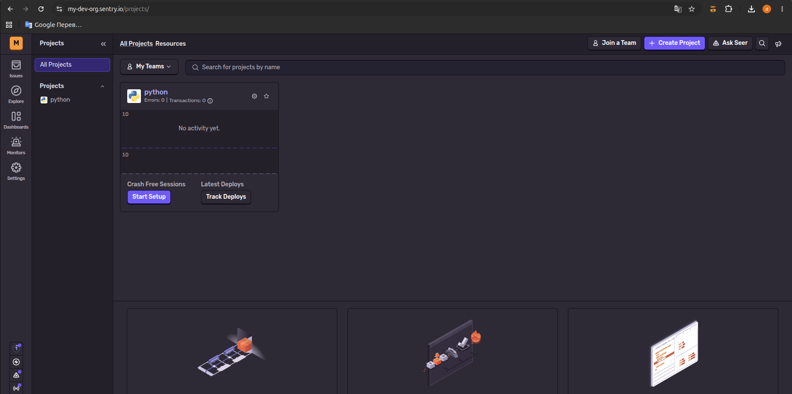
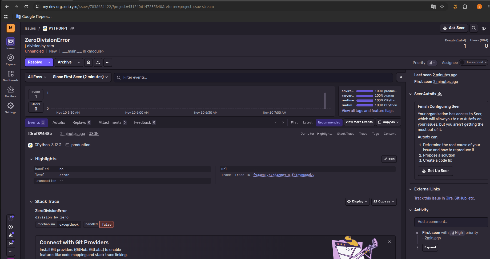
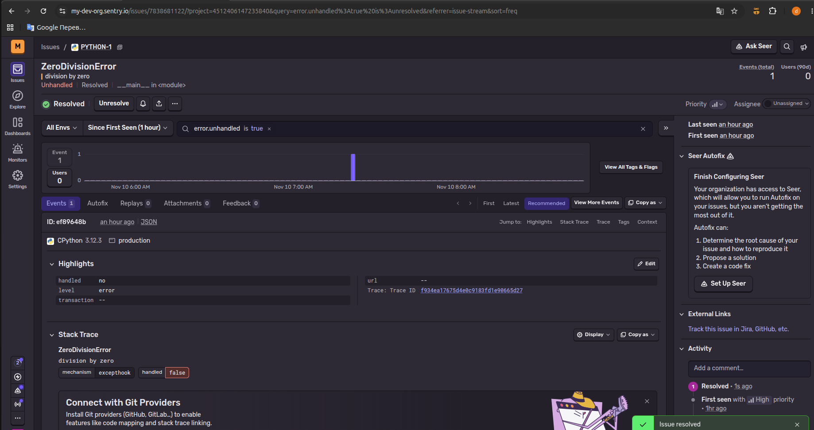
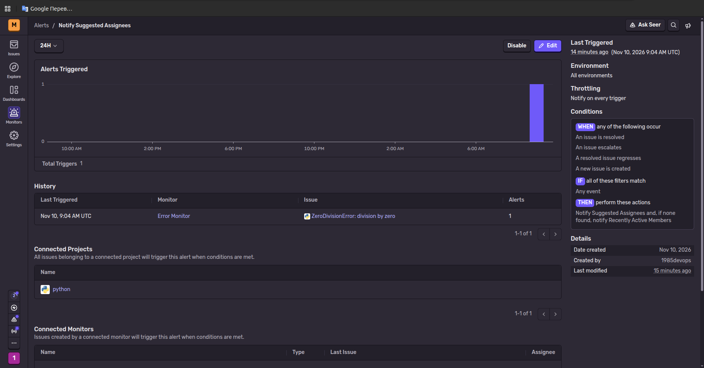
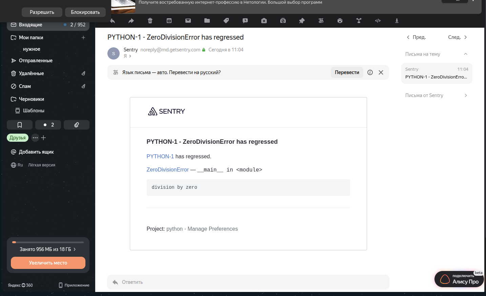
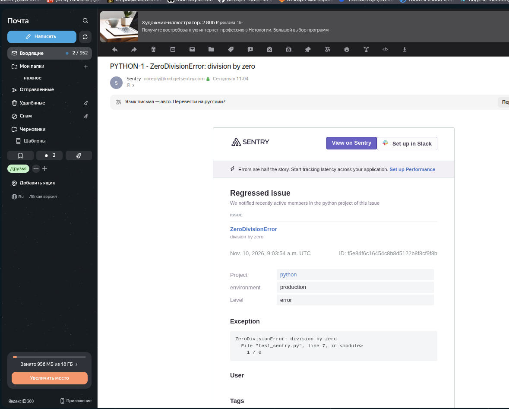

     ### Домашнее задание к занятию 16 «Платформа мониторинга Sentry» - Нугаев Алексей

## Задание 1

Так как Self-Hosted Sentry довольно требовательная к ресурсам система, мы будем использовать Free Сloud account.

Free Cloud account имеет ограничения:

- 5 000 errors;
- 10 000 transactions;
- 1 GB attachments.

Для подключения Free Cloud account:

- зайдите на sentry.io;
- нажмите «Try for free»;
- используйте авторизацию через ваш GitHub-аккаунт;
- далее следуйте инструкциям.

В качестве решения задания пришлите скриншот меню Projects.

## Задание 2

1. Создайте python-проект и нажмите `Generate sample event` для генерации тестового события.
1. Изучите информацию, представленную в событии.
1. Перейдите в список событий проекта, выберите созданное вами и нажмите `Resolved`.
1. В качестве решения задание предоставьте скриншот `Stack trace` из этого события и список событий проекта после нажатия `Resolved`.

## Задание 3

1. Перейдите в создание правил алёртинга.
2. Выберите проект и создайте дефолтное правило алёртинга без настройки полей.
3. Снова сгенерируйте событие `Generate sample event`.
Если всё было выполнено правильно — через некоторое время вам на почту, привязанную к GitHub-аккаунту, придёт оповещение о произошедшем событии.
4. Если сообщение не пришло — проверьте настройки аккаунта Sentry (например, привязанную почту), что у вас не было 
`sample issue` до того, как вы его сгенерировали, и то, что правило алёртинга выставлено по дефолту (во всех полях all).
Также проверьте проект, в котором вы создаёте событие — возможно алёрт привязан к другому.
5. В качестве решения задания пришлите скриншот тела сообщения из оповещения на почте.
6. Дополнительно поэкспериментируйте с правилами алёртинга. Выбирайте разные условия отправки и создавайте sample events. 

## Задание повышенной сложности

1. Создайте проект на ЯП Python или GO (около 10–20 строк), подключите к нему sentry SDK и отправьте несколько тестовых событий.
2. Поэкспериментируйте с различными передаваемыми параметрами, но помните об ограничениях Free учётной записи Cloud Sentry.
3. В качестве решения задания пришлите скриншот меню issues вашего проекта и пример кода подключения sentry sdk/отсылки событий.

---

### Как оформить решение задания

Выполненное домашнее задание пришлите в виде ссылки на .md-файл в вашем репозитории.

---

# Решение 1

* Зарегистрировал бесплатный облачный аккаунт Free Cloud account в сервисе Sentry с использованием авторизации через GitHub. Создал организацию с уникальным доменом my-dev-org.sentry.io.
* Создал первый демонстрационный проект на базе платформы Python Vanilla с именем python и активированным модулем отслеживания ошибок Error monitoring.
* На скрине представлена веб-панель Sentry в операционной системе Ubuntu.

# Решение 2

* В терминале Ubuntu был настроен sentry-sdk с использованием индивидуального DSN-ключа организации. Запущен тестовый Python-скрипт, вызывающий исключение деления на ноль ZeroDivisionError: division by zero.
* Ошибка была перехвачена платформой Sentry. В веб-интерфейсе зафиксирован сгенерированный Stack Trace, указывающий точную строку сбоя 1 / 0 в исходном коде.
* После чего инцидент был успешно переведен в статус Resolved в панели управления Sentry.

# Решение 2

* В разделе Alerts для проекта python создал новое правило оповещения по умолчанию Default Alert Rule с триггером на создание новых инцидентов. В качестве действия (THEN) выбрано автоматическое уведомление участников проекта Suggested Assignees.
* Из терминала Ubuntu повторно запущен тестовый Python-скрипт. Так как ранее аналогичная ошибка была переведена в статус Resolved, повторный сбой вызвал регрессию инцидента ZeroDivisionError has regressed.
* Правило алёртинга отработало корректно. На привязанный почтовый ящик в течение минуты пришло  письмо от Sentry с логами ошибки, содержанием исключения и указанием сбойного файла.

